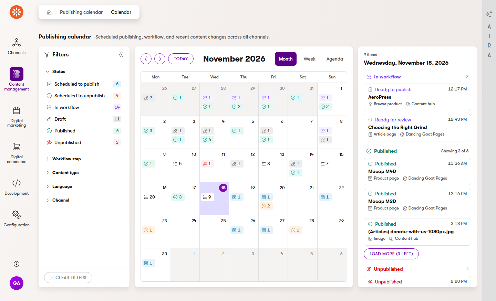
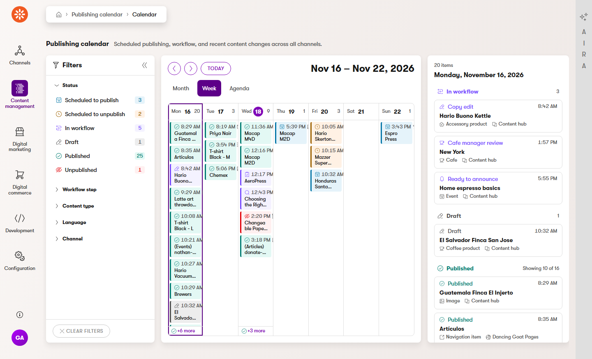
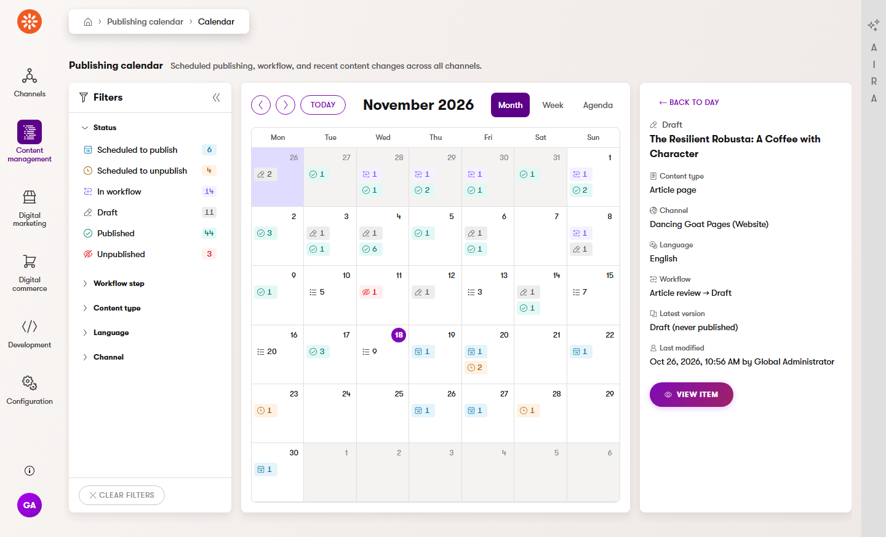

# Xperience by Kentico Labs: Publishing Calendar

[](https://github.com/Kentico/.github/blob/main/SUPPORT.md#labs-limited-support) [](https://github.com/Kentico/xperience-by-kentico-publishing-calendar/actions/workflows/ci.yml)

## Description

Adds a publishing calendar application to the Xperience administration that shows scheduled publishing, workflow, and recent content changes across all channels.

The **Publishing calendar** application (Content management category) shows content item language variants from all channels and the Content hub on a month, week, or agenda calendar: scheduled publish and unpublish dates, plus published, in-workflow, draft, and unpublished items by last modified date. Filter by content type, channel, and workflow step, and open items in their editors.

<!-- Screenshots: images/screenshots, generated by `npm run screenshots` in tests/e2e (see tests/e2e/README.md). -->







Limitations:

- Shows only the current state of each variant (latest modification or schedule), not full version history.
- Up to 62 days per request; published items load 10 per day, then on demand.
- Ignores workspace, channel, and page permissions: any role with **View** on the application sees titles, dates, workflow steps, and last editors of items in all workspaces and channels. Editors opened from the calendar still check the role's permissions.

## Requirements

### Library Version Matrix

| Xperience Version | Library Version |
| ----------------- | --------------- |
| >= 31.10.3        | 1.0.0           |

### Dependencies

- [ASP.NET Core 10.0](https://dotnet.microsoft.com/en-us/download)
- [Xperience by Kentico](https://docs.kentico.com)

## Package Installation

Add the package to your application using the .NET CLI

```powershell
dotnet add package Kentico.Xperience.Labs.PublishingCalendar.Admin
```

## Quick Start

1. Install the package (see above) in the project that hosts the administration. No registration code is needed: Xperience discovers the module at startup.
2. Rebuild and restart the application.
3. Open **Publishing calendar** in the administration. Roles other than Administrator need the **View** permission for the application.

## Full Instructions

View the [Usage Guide](./docs/Usage-Guide.md) for more detailed instructions.

## Contributing

To see the guidelines for Contributing to Kentico open source software, please see [Kentico's `CONTRIBUTING.md`](https://github.com/Kentico/.github/blob/main/CONTRIBUTING.md) for more information and follow the [Kentico's `CODE_OF_CONDUCT`](https://github.com/Kentico/.github/blob/main/CODE_OF_CONDUCT.md).

Instructions and technical details for contributing to **this** project can be found in [Contributing Setup](./docs/Contributing-Setup.md).

## License

Distributed under the MIT License. See [`LICENSE.md`](./LICENSE.md) for more information.

## Support

[](https://github.com/Kentico/.github/blob/main/SUPPORT.md#labs-limited-support)

This project has **Kentico Labs limited support**.

See [`SUPPORT.md`](https://github.com/Kentico/.github/blob/main/SUPPORT.md#labs-limited-support) for more information.

For any security issues see [`SECURITY.md`](https://github.com/Kentico/.github/blob/main/SECURITY.md).